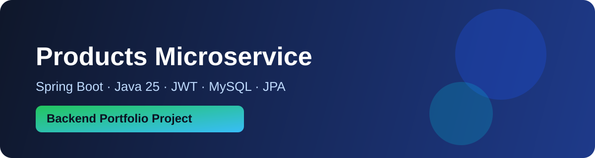

# 🛍️ Products Microservice

Proyecto base de microservicios para la gestión de productos de una tienda, diseñado como **portafolio profesional** con una estructura clara, escalable y moderna.

## ✨ Objetivo

Construir una solución backend robusta para administrar productos, con enfoque en:

- Arquitectura de microservicios
- Seguridad básica con JWT
- Persistencia con JPA sobre MySQL
- Buenas prácticas con Spring Boot y Java 25

## 🧱 Stack principal

- **Java 25**
- **Spring Boot**
- **Spring Security + JWT**
- **Spring Data JPA**
- **MySQL**

## 📦 Alcance funcional inicial

- CRUD de productos
- Seguridad con autenticación basada en JWT
- Gestión de roles/permisos básicos
- Estructura lista para crecimiento por dominios/microservicios

## 🗂️ Roadmap

- [x] Definir visión y base del proyecto
- [ ] Implementar microservicio de productos
- [ ] Integrar seguridad JWT end-to-end
- [ ] Configurar persistencia MySQL + JPA
- [ ] Preparar documentación técnica y ejemplos de uso

## 🤝 Enfoque de portafolio

Este repositorio busca demostrar experiencia en desarrollo backend empresarial:

- Diseño limpio y mantenible
- Documentación presentable
- Base técnica real para evolucionar a un ecosistema de microservicios